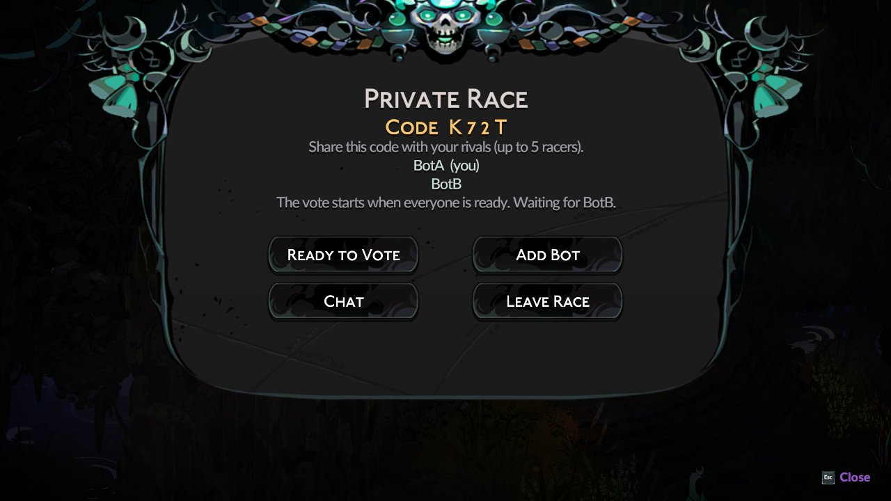
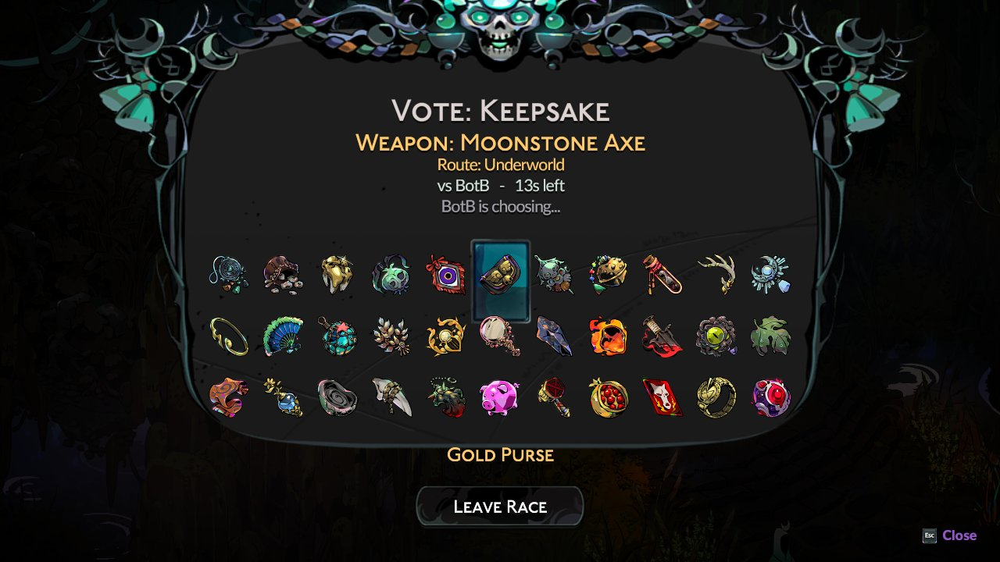
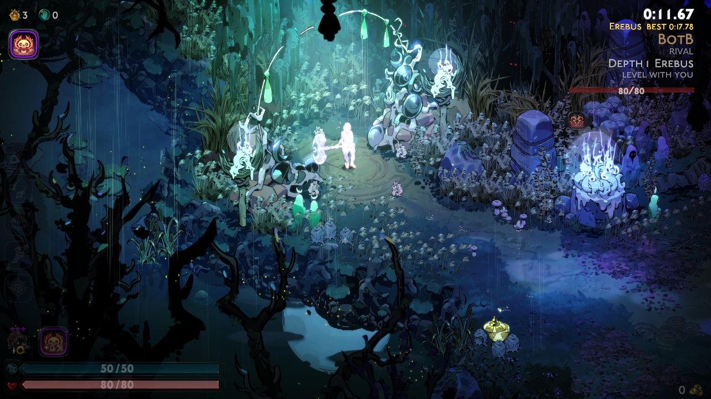
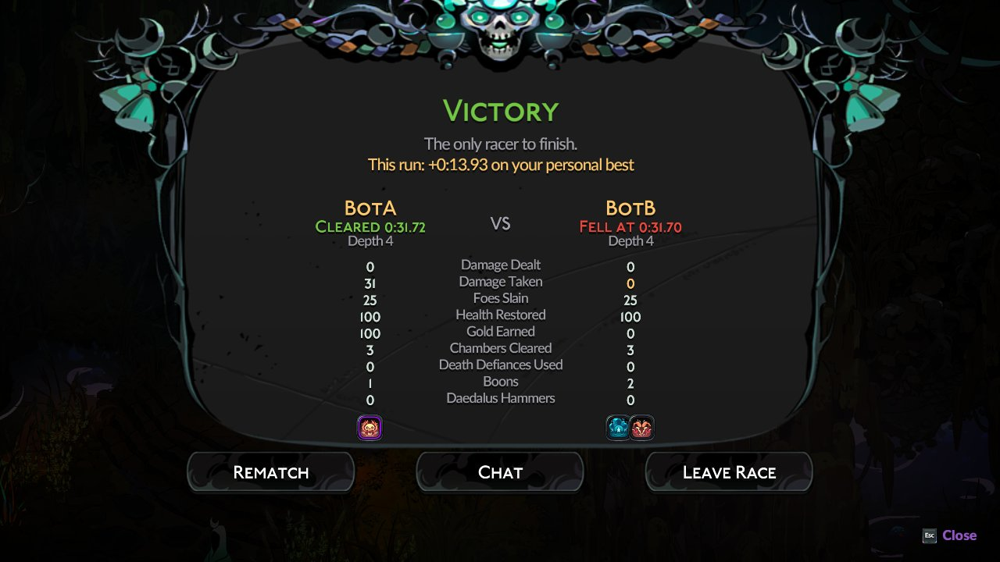

# Hades 2 Competitive Speedrunning (Beta)

Hades 2 Competitive Speedrunning (H2CS) is a race mod for Hades II inspired by [Minecraft Speedrunning Ranked](https://wiki.mcsrranked.com)

Players race on identical seeds using matching weapons and starting keepsakes. Encounters and rewards will be the same -- the only difference is player skill. 

H2CS uses a separate, maxed out save profile with all content unlocked. Expect to see spoilers!









## Play

See **[INSTALL.md](INSTALL.md)**: one script per system (Windows, Linux / Steam
Deck) installs the mod loader, its dependencies and the mod; then set one Steam
launch option and pick **Play Competitive Speedrun** on the title screen. It also
has step-by-step instructions for an AI agent installing it for you.

**Updating** (with the game closed; your name and settings stay):

- Linux / Steam Deck: `curl -fsSL https://raw.githubusercontent.com/schmidtwmark/hades2-competitive-speedrunning/main/install/update.sh | bash`
- Windows (PowerShell): `irm https://raw.githubusercontent.com/schmidtwmark/hades2-competitive-speedrunning/main/install/update.ps1 | iex`

## Server

The public server runs on Railway (project `hades2-ranked-race`, service
`race-server`) at **`hopper.proxy.rlwy.net:16303`**, which is the mod's default.
It is plain TCP behind Railway's TCP proxy, not HTTP. Redeploy after server
changes with:

```bash
scripts/railway-deploy.sh
```

To run your own instead:

```bash
cd server && npm install && npm run build && PORT=7777 npm start
```

Plain TCP, newline-delimited JSON; message types are in `server/src/protocol.ts`.

With `STATUS_PORT` set (Railway: 8080, on the service's web domain), the server
also serves a public status page there ([live](https://race-server-production-2da9.up.railway.app/)): how many are online, looking for a
match and racing, and each race under way, without racer names or lobby codes.
`/status.json` has the same as data.

## Development

See [CLAUDE.md](CLAUDE.md) for layout and commands and [NOTES.md](NOTES.md) for
what has been verified in the game. `scripts/suite.sh --game` runs everything,
including two real game clients racing each other on the Linux test PC.

## Future Plans

H2CS is a beta project, released now to gauge interest. If people like this, I have lots of ideas for further improvements:

- Host / Browse architecture where host sets rules
- ELO system for persistent ranking / matchmaking
- Server-side verification for detecting cheating
- Spectate mode after you finish your run
- Fear selection
- Saved runs / racing against Ghosts
- Chat messages for boon selections
- Steam friend invites
- Option to enable respawning on death

## How it was made, and license

This mod was developed with AI (Claude), and it is fully open
source under the [MIT License](LICENSE). It is a fan project, not affiliated with
Supergiant Games; Hades II and its assets belong to Supergiant. The installers
download the mod loader and libraries from Thunderstore; nothing from the game is
included here.
